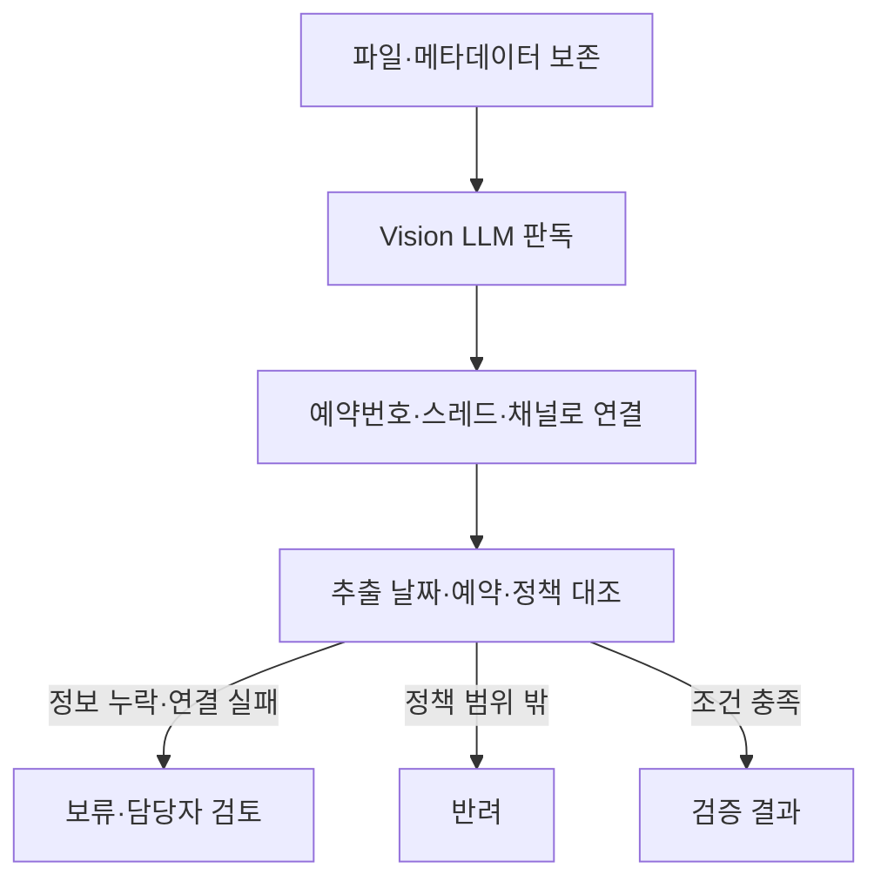

# 결항 확인서 자동화 — 판독 결과와 업무 판정의 분리

카모아 인턴 업무, 2026.03–04. 2인 중 AI 판독·예약 대조 파이프라인과 백엔드를 담당했습니다. Python·Slack Bolt·PostgreSQL·Vision LLM·Docker·AWS EC2를 사용했습니다. 정산 봇 전체를 단독 개발했다는 의미는 아닙니다.

## 문제와 처리 흐름

서식이 다른 문서에서 추출한 정보를 실제 예약과 연결해야 했습니다. Slack 검색에만 의존하지 않도록 예약번호·스레드·채널을 DB에 매핑했습니다. 문서 파일을 먼저 보존하고 후속 판독을 분리해 분석 예외가 원본 파일 유실로 이어지지 않도록 했습니다.

판독과 판단을 나눠 AI가 추출한 내용을 업무 처리 완료로 바로 취급하지 않았습니다. 검증 결과는 실제 환불 완료와 다릅니다. 요청 한도 계열 오류에 한해 Gemini에서 GPT 대체 판독을 호출하며, 모든 오류를 자동 복구하는 구조로 표현하지 않습니다.

## 합성 사례로 읽는 경계

| 합성 입력 상황 | 설명할 처리 |
|---|---|
| 날짜가 빠진 문서 | 누락 정보를 확정하지 않고 보류 |
| 예약번호·스레드 연결 실패 | 예약을 추정하지 않고 검토로 분기 |
| 모델 호출 제한 오류 | 확인한 조건에서만 대체 판독 경로 호출 |

이 표는 확인한 코드 분기를 설명하는 예시입니다. 새로 실행한 정답률 평가나 실제 고객 사건 기록이 아닙니다. 회사 문서·예약 데이터·Slack 원문은 포함하지 않았습니다.

[공개 저장소](https://github.com/min1336/ai-slackapp) · [구현 확인 버전](https://github.com/min1336/ai-slackapp/tree/3e221cf2b8df2d782897861c0684a8ad5d6b6421)
