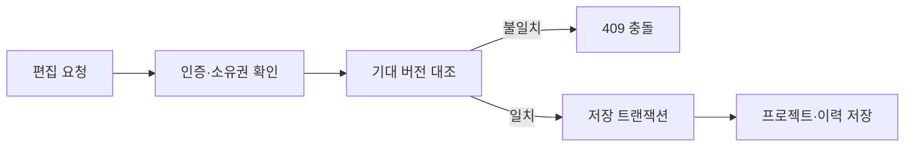
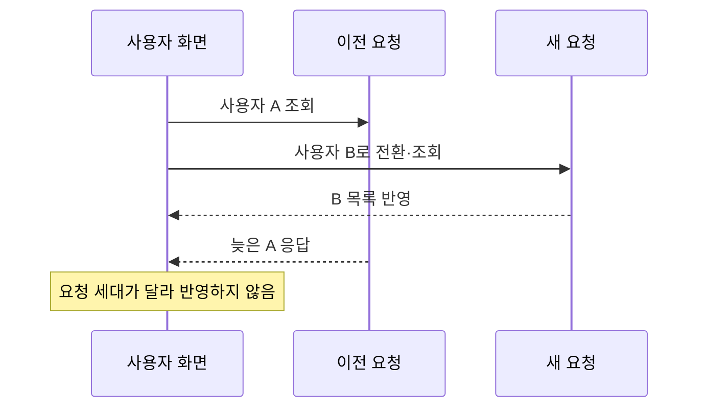

# EMOLAB — 편집 데이터와 분석 결과의 일관성

공개 이모티콘 메타데이터 비교와 자체 세트 편집·AI 분석을 연결하는 도구입니다. 기획·React/TypeScript 클라이언트·Express 서버를 1인 개발했습니다. 저장소는 비공개이며 이 문서는 소스 대신 공개 가능한 동작과 검증 범위를 설명합니다. 정확한 개발기간은 미확인입니다.

[공개 화면](https://emolab-kr.vercel.app/) · 화면 접속만으로 로그인·저장·AI 기능 전체가 검증되는 것은 아닙니다.

## 1. 저장 요청의 기대 버전과 이력

서로 다른 시점에 읽은 프로젝트를 같은 데이터로 덮어쓰지 않도록 저장 요청의 기대 버전과 현재 버전을 대조했습니다. 로그인 사용자와 소유권을 확인하고, 변경 데이터와 이력을 같은 트랜잭션에 저장합니다. 기대 버전이 제공된 요청에서 불일치하면 충돌을 반환합니다.

기존 로컬 테스트를 2026-10-27 다시 실행해 14개가 통과했습니다. 임시 SQLite를 두 연결로 열고 같은 버전의 변경을 동시에 요청하는 테스트에서 성공 1건·ProjectConflict 1건, 이미지 보존과 이력 개수를 확인했습니다. 추가한 중복 이미지 키 오류 검증은 프로젝트·이력·기존 이미지의 롤백도 확인했습니다. 별도의 모의 AI/HTTP 테스트는 오래된 기대 버전 요청의 409를 확인합니다. 배포 Turso의 부하나 모든 API의 필수 버전 검증을 입증한 결과는 아닙니다.

## 2. 늦은 응답과 분석 스냅샷

사용자가 전환된 뒤 이전 사용자의 요청이 늦게 도착할 수 있어 요청 세대 값을 대조합니다. 분석 결과가 현재 목록과 다른 스냅샷을 참조하면 목록을 다시 조회합니다. 같은 스냅샷이면 보고서만 반영합니다.

이 구조의 목적은 조회 시점과 사용자가 다른 결과를 같은 화면에 섞지 않는 것입니다. 실제 사용자에게 오류가 발생한 운영 기록이나 사용자 개선율은 별도로 측정하지 않았습니다.

## 3. 부분 업로드

여러 파일을 순서대로 업로드하면서 성공한 프로젝트 상태와 저장 개수를 반영합니다. 이후 파일이 실패하면 이미 저장한 컷을 유지하고 완료 개수·오류를 함께 표시합니다. 파일 형식·개별 용량·전체 용량·컷 수는 업로드 전에 검사합니다.

## 검증의 경계

2026-10-27 실제 React 컴포넌트와 headless Chrome에서 합성 API 응답으로 다음 4개를 확인했습니다: 이전 사용자 응답 차단, 스냅샷 불일치 시 목록 재조회, 동일 스냅샷의 보고서 반영, 두 파일 중 두 번째 실패 시 첫 컷 유지·완료 개수와 오류 표시·재업로드 가능. [검증 명세](../verification.md)를 함께 제공합니다. 합성 API 응답 검증은 실서버 저장·이미지 인식·유료 AI·운영 품질 검증과 다릅니다. 로컬 코드와 공개 배포가 같은 버전이라고 가정하지 않습니다.
