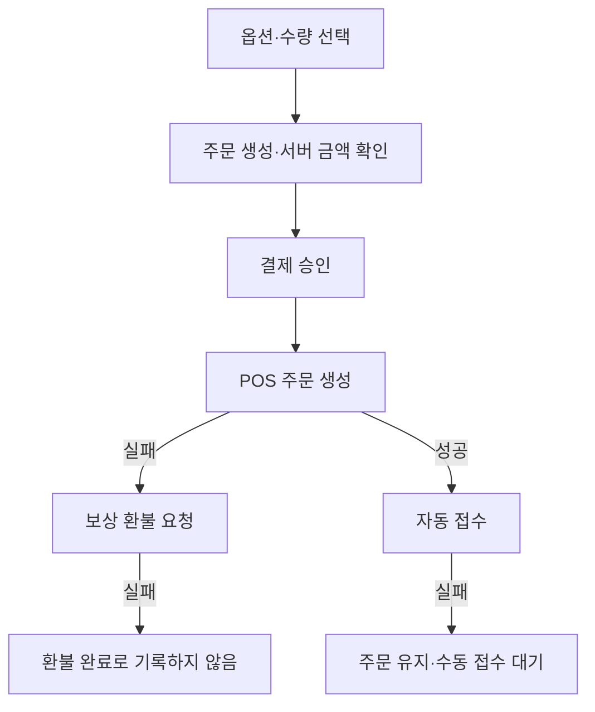

# Marinoi / ORI543 — 주문부터 매장 접수까지

2026.08부터 진행한 프리랜서 1인 개발입니다. Next.js·React·TypeScript, Supabase/PostgreSQL, Toss Payments·Toss Place를 사용합니다.

[공개 메뉴 화면](https://ori543.vercel.app/)

## 사용자 작업과 설계

화면에서 필수 옵션과 수량에 따른 금액을 표시하고 주문을 생성합니다. 결제 응답에 따라 성공·오류를 안내하고 주문 조회로 연결합니다. 서버는 화면 계산만 신뢰하지 않고 저장 주문 금액과 요청을 대조하며, 기승인 주문의 재요청에 기존 결과를 반환합니다.

사용자의 결제 성공과 매장의 접수 성공은 다른 사건입니다. 하나의 성공 값으로 합치지 않고 외부 API가 어느 단계까지 처리했는지에 따라 후속 조치를 나눴습니다.

그림의 문구는 처리 흐름을 설명하며 DB 열거형 상태명 자체가 아닙니다. 실제 구현하지 않은 자동 재시도나 복구 완료를 뜻하지 않습니다.

## 데이터 경계와 검증

팀 지갑은 원자적 잔액 변경과 중복 처리 방지 키·인덱스를 사용합니다. RLS와 서버 핸들러의 접근 권한 처리를 연결했습니다.

2026-10-25 로컬 승인·취소 API 테스트 30개가 통과했습니다. 금액 불일치, 기승인 요청, POS 실패 뒤 환불 실패 등 분기를 다룹니다. DB·결제·POS는 모의 응답입니다. 실거래·운영 DB 동시 부하·매장 사용 성과는 이 테스트로 입증하지 않습니다.

저장소는 비공개이며 업무 데이터·인증 정보·결제 원문을 이 사례에 공개하지 않습니다.
