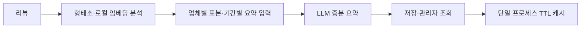

# 리뷰 AI — 분석과 요약 생성을 분리한 관리자 도구

카모아 인턴 업무, 2026.01–03. 기획·분석 파이프라인·백엔드·관리자 화면·배포를 1인 담당했습니다. Python·FastAPI·PostgreSQL·SQLAlchemy·Kiwi·FastEmbed·OpenAI API·Docker·AWS를 사용했습니다.

## 문제와 구조

렌터카 리뷰를 감정·속성별로 분석하고 업체별 요약을 조회하는 도구입니다. 전체 리뷰를 매번 LLM으로 처리하는 대신, 형태소·로컬 임베딩 분석과 요약 생성을 분리했습니다. 업체별 표본과 기간을 고려한 증분 요약을 구성하고 결과를 관리자 화면에서 조회하도록 연결했습니다.

## 선택 범위와 한계

조회에 TTL 메모리 캐시와 갱신 중복 방지를 적용했습니다. 단일 프로세스의 캐시이므로 다중 인스턴스의 공유 캐시 운영과는 범위가 다릅니다. Redis는 확장 시 검토할 선택지이며 실제 운영 실적으로 기재하지 않습니다.

현재 확인한 화면 구조와 React 버전의 관계는 미확인입니다. 처리량·응답 시간·비용 절감률은 원본 측정 조건이 확보되지 않아 성과로 제시하지 않습니다. 공개 저장소의 과거 README에 있는 수치와 이 사례의 검증 범위를 구분합니다. 저장소 전체 기능을 개인 기여로 확대하지 않습니다.

[공개 저장소](https://github.com/min1336/review-master) · [구현을 확인한 버전의 README](https://github.com/min1336/review-master/blob/df3bdaeb4c56089d01750e82e43ecb51bc53fef6/README.md)
